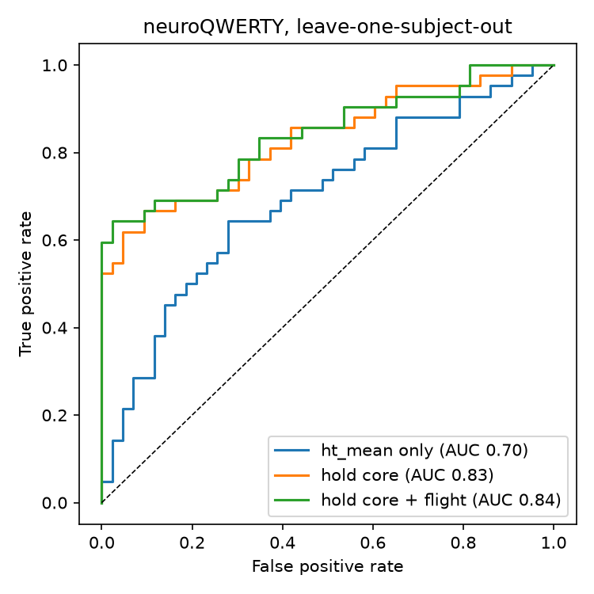
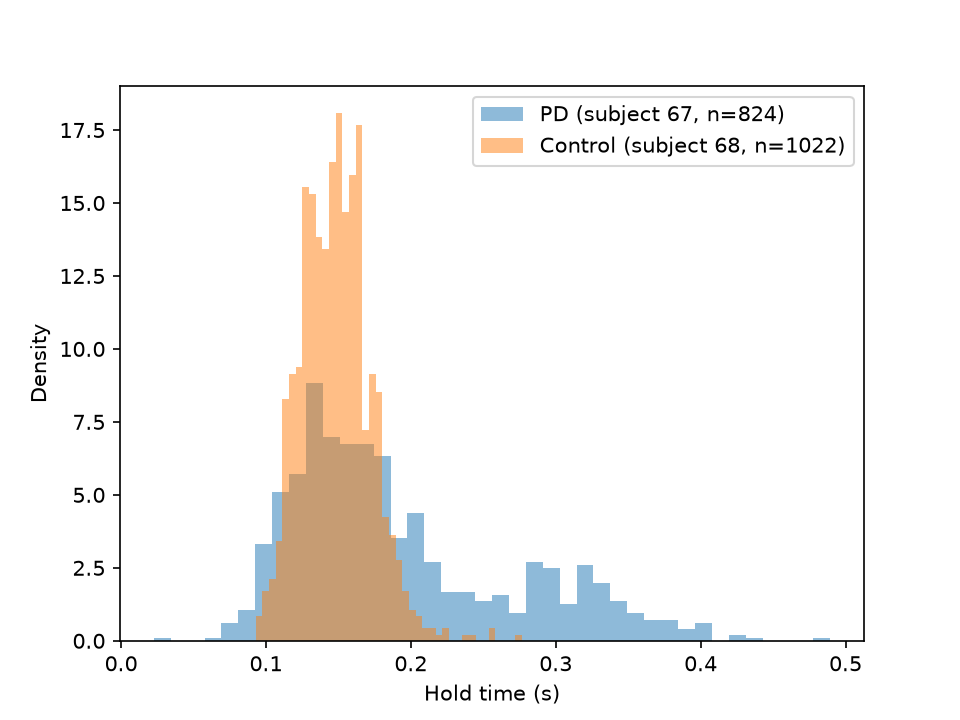

# Keystroke Dynamics for Parkinson's Disease Detection

Can ordinary typing reveal early Parkinson's disease (PD), and why do keystroke
classifiers that work on clinic data tend to lose accuracy on data collected at
home?

**Research question:** Why does the keystroke signal for PD survive a clinic
setting but weaken in unsupervised, free-living collection?

**Status:** Part 1 (clinic data, neuroQWERTY) is done: loader, features,
leave-one-subject-out baseline and checks. Part 2 (home data, Tappy) has not
started, so the question above is not answered yet. See [Roadmap](#roadmap).

---

## What I found so far (neuroQWERTY, 85 subjects, 42 with PD)

- **A hold-time model reproduces the published level.** Leave-one-subject-out AUC
  is 0.83 (95% CI 0.74 to 0.91) for logistic regression on hold-time features. The
  authors' own nQi score, shipped with the dataset, gives 0.81 on the same
  subjects.
- **The spread of hold time carries the signal, not the average.** On its own, the
  standard deviation of hold time reaches AUC 0.83 and the mean absolute
  consecutive difference 0.82, against 0.73 for the mean and 0.67 for the median.
  A model on the mean alone gets 0.70 under LOSO.
- **It is comparable to a clinical tapping test, not better.** On the 76 subjects
  with an alternating-finger-tapping score, hold time scores 0.81 and tapping
  0.83. The difference is -0.02 with a 95% interval of -0.17 to +0.12, so this
  data cannot separate them. Single-key tapping scores 0.61.
- **The result is not a leakage artefact.** With the labels shuffled, the same
  pipeline scores a mean AUC of 0.43 (95% range 0.21 to 0.60); the real 0.83 is
  outside that range (p = 0.005 with 200 shuffles).
- **A left-hand pattern I saw in one subject does not generalise.** Subject 67
  (PD) held left-hand keys such as `a` and `s` about 1.7 to 1.9 times as long as
  the control, while right-hand keys were close to normal. Across all 85
  subjects the left/right difference gives AUC 0.57 (CI 0.44 to 0.69).
- **Transfer between the two clinic studies is uneven.** Training on one study and
  testing on the other gives 0.69 for CS1PD to CS2PD and 0.87 for the reverse. The
  intervals are wide, so this is a hint of cohort shift, not a finding.

## Background

Fine motor control degrades early in PD, often before visible tremor. Typing is a
dense stream of timed finger movements, so keystroke timing can act as a passive
motor assessment that needs no wearable and no dedicated test.

| Feature | Definition |
|---|---|
| Hold time (HT) | Key press to key release |
| Flight time (FT) | Release of one key to press of the next |

The neuroQWERTY index (nQi) from the original dataset paper reaches an AUC of
about 0.81. That figure is from my project notes and I have not re-checked it
against the paper. Note that nQi is a model built from hold-time features, not a
single raw feature, and in this data it does not beat the clinical tapping test
(see above).

## Data

| Dataset | Subjects | Setting | Status |
|---|---|---|---|
| neuroQWERTY MIT-CSXPD | 85 (42 PD, 43 control) | Clinic study, free text | Analysed |
| Tappy | 200+ | Home, unsupervised | Not yet downloaded |

Raw data is **not** committed. See [`data/README.md`](data/README.md) for download
steps, the cleaning log and dataset quirks.

| Study folder | Subjects | PD | Sessions per subject |
|---|---|---|---|
| `MIT-CS1PD` | 31 | 18 | 2 |
| `MIT-CS2PD` | 54 | 24 | 1 |

Session files have no header: key name, hold time, release time, press time, all in
seconds from the start of the session. Labels, UPDRS, tapping scores and nQi are in
the `GT_DataPD_*.csv` files.

### Cleaning

I follow the dataset authors' rules: drop keystrokes with non-positive times, hold
times outside [0, 5) s, or press times that go backwards within a session. That
removes 2.01% of keystrokes, at the same rate in both groups (1.79% control, 1.73%
PD). Mouse events, Shift/Alt/Control and BackSpace are then removed, leaving 94.6%
of the raw keystrokes. Shift holds alone create the long tail of the hold-time
distribution; in one sample session, dropping 5 modifier rows (0.5%) cut the
hold-time standard deviation from 0.063 s to 0.024 s.

## Method

**Features** (`src/features.py`), one row per subject with both sessions pooled:
hold-time mean, median, standard deviation, IQR, skewness, kurtosis and mean
absolute consecutive difference; flight-time median and IQR; and median hold time
for left-hand and right-hand keys plus their absolute difference. The hand split
uses the standard touch-typing finger map and was fixed before any model was run.

**Evaluation** (`src/evaluate.py`):

- Leave-one-subject-out cross-validation. One subject is one sample, so the same
  person is never on both sides of a split.
- Scaling is part of the model pipeline, so it is fitted on training subjects only.
  Nothing is tuned, so there is no inner loop to leak from.
- A held-out subject has a single label, so AUC is computed once over all
  out-of-fold scores, with a 95% interval from resampling subjects.
- Direction of each single-feature AUC is fixed in advance (PD is the positive
  class, a higher value means more PD) and not flipped after looking.
- A label-permutation test and a paired bootstrap for AUC differences.

Run everything with `python -m src.baseline`. It writes
[`results/baseline_neuroqwerty.csv`](results/baseline_neuroqwerty.csv) and
`results/baseline_roc.png`.

## Results

| Analysis | AUC | 95% CI |
|---|---|---|
| nQi score shipped with the dataset | 0.81 | 0.71 to 0.90 |
| Alternating finger tapping (n = 76) | 0.83 | 0.74 to 0.92 |
| Single-key tapping | 0.61 | 0.49 to 0.73 |
| Typing speed | 0.56 | 0.44 to 0.68 |
| Single feature: hold-time std | 0.83 | 0.73 to 0.91 |
| Single feature: hold-time mean | 0.73 | 0.62 to 0.83 |
| LOSO logistic regression, hold-time features | 0.83 | 0.74 to 0.91 |
| ... plus flight time | 0.84 | 0.75 to 0.92 |
| ... plus hand features | 0.86 | 0.78 to 0.94 |
| LOSO random forest, hold + flight | 0.76 | 0.64 to 0.86 |
| LOSO within CS1PD only | 0.80 | 0.61 to 0.95 |
| LOSO within CS2PD only | 0.83 | 0.70 to 0.93 |
| Train CS1PD, test CS2PD | 0.69 | 0.53 to 0.82 |
| Train CS2PD, test CS1PD | 0.87 | 0.72 to 0.98 |





The histogram shows one PD subject (67) and one control (68) with similar typing
speeds. It motivated the hand-level analysis, which did not hold up (see below).
The full table, including every single feature, is in the results CSV.

## Limitations

- 85 subjects. Every interval above is wide, and differences of a few hundredths of
  AUC are noise. Adding hand features (0.84 to 0.86) is inside that noise.
- I looked at 12 single features, so the best of them (std, 0.83) is an optimistic
  estimate of that feature. The LOSO models are not affected by this.
- Both studies are clinic recordings distributed together as one dataset, so the
  cross-study check is a weak proxy for the clinic-to-home gap.
- No age, sex or medication information is used, so I cannot rule out those as
  confounders. Typing speed alone is weak (0.56), which argues against it.
- The press-time-goes-backwards rule also drops some genuine letters typed with
  overlapping fingers. I kept it to match the authors.
- The 0.81 and the tapping comparison from the original paper come from my notes
  and are not independently verified; the numbers in the table are my own.

## What didn't work

- **Left/right asymmetry.** Not supported across subjects (AUC 0.57), despite how
  clear it looked in subject 67. One subject per group was too little to build a
  hypothesis on.
- **Skewness and kurtosis** of hold time are near chance (0.55 and 0.53), and
  flight-time features add little (0.57 on their own).
- **A random forest** does worse than logistic regression (0.76 against 0.84), as
  expected with 85 samples.
- **A labelling bug in my own scratch code**: `row.gt` on a pandas row returns the
  `Series.gt` method, not the `gt` column, which silently labelled every session as
  PD. I caught it because controls were missing from a groupby. The repo code uses
  `row["gt"]`.
- **UPDRS as a comparison**: it separates the groups perfectly (controls 0 to 6, PD
  7 and above), so it defines the label and is not an independent benchmark.
- **Pinned dependencies** (`numpy==1.26.4`) have no wheels for Python 3.13 and
  failed to build; the requirements are unpinned.
- The authors' loader (`nqDataLoader.py`) is Python 2 and does not run today; I used
  it as a specification only.

## Roadmap

- [x] Download neuroQWERTY and validate the file format
- [x] Loader and cleaning for all subjects (`src/load.py`)
- [x] Per-subject features (`src/features.py`)
- [x] LOSO baseline, permutation test, comparison with tapping (`src/evaluate.py`,
      `src/baseline.py`)
- [ ] Download Tappy and write its loader (different layout: millisecond hold time,
      hand and direction instead of key names, self-reported label)
- [ ] Repeat the evaluation on Tappy with the hold-time features both datasets share
- [ ] Analyse why the signal degrades in free-living data

## Setup

Requires Python 3.11 or later; developed on Python 3.13 on Windows.

```bash
git clone https://github.com/Pratyakshya10/keystroke-pd.git
cd keystroke-pd
python -m venv .venv
```

Activate the environment, then install dependencies:

```bash
# Windows (PowerShell)
.venv\Scripts\Activate.ps1
# macOS / Linux
source .venv/bin/activate

pip install -r requirements.txt
```

Download the neuroQWERTY ZIP from PhysioNet and extract it into
`data/raw/neuroqwerty/` so that `data/raw/neuroqwerty/MIT-CS1PD/` exists, then:

```bash
python -m src.baseline
```

`notebooks/01_explore.ipynb` holds the first look at the raw files.

## Repository layout

```
data/        Dataset notes and cleaning log; raw data is gitignored
notebooks/   Exploratory analysis
results/     Figures and tables
src/         load.py, features.py, evaluate.py, baseline.py
```

## References

- Giancardo L., Sánchez-Ferro A., Arroyo-Gallego T., et al. Computer keyboard
  interaction as an indicator of early Parkinson's disease. *Scientific Reports*,
  2016. (neuroQWERTY index.)
- neuroQWERTY MIT-CSXPD Dataset, PhysioNet.
- Tappy Keystroke Data, PhysioNet (Open Data Commons Attribution License v1.0).
- Cross-dataset benchmark of deep learning architectures on four public keystroke
  PD datasets (2025). Full citation to be added.
