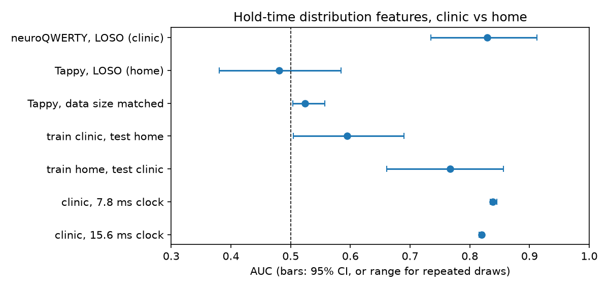

# Keystroke Dynamics for Parkinson's Disease Detection

Can ordinary typing reveal Parkinson's disease (PD), and why do keystroke
classifiers that work on clinic data tend to lose accuracy on data collected at
home?

**Research question:** Why does the keystroke signal for PD survive a clinic
setting but weaken in unsupervised, free-living collection?

**Status:** Both datasets are analysed. The clinic result reproduces; on home data
the same features show no detectable signal. I ruled out three simple
explanations, but the clinic and home datasets differ in more than setting, so the
cause of the gap is still open. See [What explains the gap](#what-explains-the-gap).

---

## What I found

**Clinic data (neuroQWERTY, 85 subjects, 42 with PD)**

- A logistic regression on hold-time features reaches leave-one-subject-out AUC
  0.83 (95% CI 0.74 to 0.91). The authors' own nQi score, shipped with the dataset,
  gives 0.81 on the same subjects.
- The spread of hold time carries the signal, not the average. The standard
  deviation alone reaches 0.83, the mean only 0.73.
- It is comparable to a clinical tapping test, not better. On the 76 subjects with a
  tapping score, hold time scores 0.81 and alternating finger tapping 0.83; the
  difference is -0.02 (95% interval -0.17 to +0.12).
- Shuffling the labels drops the pipeline to chance (mean AUC 0.43), so the result is
  not a leakage artefact.

**Home data (Tappy, 177 users, 134 with PD)**

- The same features and model give AUC 0.48 (95% CI 0.38 to 0.58). That is
  indistinguishable from chance (label-permutation p = 0.45). The best single feature
  reaches 0.59.
- The group difference shrinks. For hold-time spread the effect size falls from
  Cohen's d 1.33 in the clinic to 0.29 at home; for median hold time from 0.67 to
  0.24.
- The shrinkage comes mostly from the controls. Median hold time is about 122 ms (clinic)
  and 117 ms (home) for PD, but 92 ms (clinic) against 109 ms (home) for controls.
  Hold-time spread is 44 and 42 ms for PD, 28 and 37 ms for controls. At home,
  controls look more like PD. These are different people, not the same people
  measured twice.
- Richer features (hold time by hand, latency by key direction, 20 features in
  total) do not bring the signal back: AUC 0.48 for logistic regression, 0.51 for a
  random forest. This block was added after seeing the first result and is
  exploratory.

## What explains the gap

| Explanation | Test | Outcome |
|---|---|---|
| Home users have fewer keystrokes | Subsample every Tappy user to 1,500 keystrokes (clinic size) | AUC 0.52, no recovery. Using all data of users with 1,500 or more: 0.51 |
| Home recorder clock is coarse (most hold times sit on a 7.8 ms grid) | Degrade the clinic data to 7.8 ms and 15.6 ms ticks | AUC 0.84 and 0.82, no loss. Resolution alone does not explain it |
| Home PD users are treated or less affected | AUC against controls by levodopa use and self-reported impact | 0.51 on levodopa, 0.42 off, 0.48 mild, 0.49 medium, 0.47 severe. No subgroup stands out |
| Age confound | AUC of birth year alone | 0.52, no age difference |
| Features too limited | Add hold by hand and latency by direction | No recovery (see above) |
| Different populations, label quality, hardware | Not testable here | Open |

The transfer test points the same way. A model trained on clinic data and applied to
Tappy scores 0.60 (0.50 to 0.69). A model trained on Tappy and applied to the
clinic scores 0.77 (0.66 to 0.86). That suggests the direction it learned is roughly
right, even though the home signal is too weak to rank users within Tappy itself.

So the loss is not a data-volume or timestamp-resolution effect, and it is not
concentrated in treated or mild patients. What remains are differences I cannot
separate with these data: the Tappy label is self-reported and the PD group is
established and mostly treated (112 of 169 take levodopa); the users type on their
own, varied hardware; and the two datasets are different people. "Clinic against
home" is therefore confounded with cohort, label quality and device.

## Background

Fine motor control degrades early in PD, often before visible tremor. Typing is a
dense stream of timed finger movements, so keystroke timing can act as a passive
motor assessment that needs no wearable and no dedicated test.

| Feature | Definition |
|---|---|
| Hold time (HT) | Key press to key release |
| Flight time (FT) | Release of one key to press of the next |

The neuroQWERTY index (nQi) from the original dataset paper reaches an AUC of
about 0.81. That figure is from my project notes and I have not re-checked it
against the paper. Note that nQi is a model built from hold-time features, not a
single raw feature, and in this data it does not beat the clinical tapping test.
My notes also cite 46 to 71% AUC for deep models on Tappy; that is in line with
the weak signal here, but I have not verified it either.

## Data

| Dataset | Users | PD | Setting | Label |
|---|---|---|---|---|
| neuroQWERTY MIT-CSXPD | 85 | 42 | Clinic study, free text | Clinical |
| Tappy | 217 with a label and data (177 used) | 162 (134 used) | Own computers, months, unsupervised | Self-reported |

Raw data is **not** committed. See [`data/README.md`](data/README.md) for download
steps, the cleaning logs and dataset quirks.

- **neuroQWERTY** has two studies (`MIT-CS1PD`: 31 subjects, 2 sessions each;
  `MIT-CS2PD`: 54 subjects, 1 session). Session files give key name, hold, release
  and press time in seconds. Labels, UPDRS and tapping scores are in `GT_DataPD_*.csv`.
- **Tappy** has 9.0 million keystrokes with hold time in milliseconds, the hand and a
  direction code, but no key names. Labels come from `User_*.txt`. 49 users with data
  have no label file and are left out.

### Cleaning

The same rules apply to both: drop non-positive times, hold times outside [0, 5) s, and
press times that go backwards in a session (the dataset authors' rules). This removes
2.01% of neuroQWERTY and 2.07% of Tappy keystrokes. For neuroQWERTY, mouse events,
Shift/Alt/Control and BackSpace are then removed too (94.6% of keystrokes kept); Shift
holds alone create the long tail of the hold-time distribution. Tappy also has 363
unparseable lines.

## Method

**Features** (`src/features.py`). For neuroQWERTY, one row per subject with sessions
pooled: hold-time mean, median, standard deviation, IQR, skewness, kurtosis and mean
absolute consecutive difference; flight-time median and IQR; left- and right-hand
median hold time and their difference. For the clinic-versus-home comparison only the
six hold-time distribution features are used (mean, median, std, IQR, skew,
kurtosis), because Tappy has no key names and its consecutive keystrokes are not
comparable across long pauses.

**Evaluation** (`src/evaluate.py`):

- Leave-one-subject-out cross-validation, one subject (or user) per sample, so no
  person is ever on both sides of a split.
- Scaling is part of the model pipeline, so it is fitted on training subjects only.
  Nothing is tuned, so there is no inner loop to leak from.
- A held-out subject has one label, so AUC is computed once over all out-of-fold
  scores, with a 95% interval from resampling subjects.
- Single-feature AUC directions are fixed in advance (PD is the positive class, higher
  value means more PD) and not flipped after looking.
- Label-permutation tests and a paired bootstrap for AUC differences. Leave-one-out
  sits below 0.5 when there is no signal (the permutation null is 0.43 to 0.45), so
  read an AUC near 0.45 as "nothing" and not as "wrong direction".

**Pre-specified versus exploratory.** The Tappy plan (hold-time distribution features,
an inclusion rule of at least 299 clean keystrokes, the same model, the tests above)
was fixed before running any Tappy model; it is written at the top of
`src/tappy_baseline.py`. I had seen per-class median hold times and keystroke counts
but no AUC. The richer-feature block and the 169-user subset it needs came afterwards
and are marked EXPLORATORY in the results.

Run everything with `python -m src.baseline` (clinic) and `python -m src.tappy_baseline`
(clinic against home).

## Results

### Clinic (neuroQWERTY)

| Analysis | AUC | 95% CI |
|---|---|---|
| nQi score shipped with the dataset | 0.81 | 0.71 to 0.90 |
| Alternating finger tapping (n = 76) | 0.83 | 0.74 to 0.92 |
| Single-key tapping | 0.61 | 0.49 to 0.73 |
| Typing speed | 0.56 | 0.44 to 0.68 |
| Single feature: hold-time std | 0.83 | 0.73 to 0.91 |
| Single feature: hold-time mean | 0.73 | 0.62 to 0.83 |
| LOSO logistic regression, hold-time features | 0.83 | 0.74 to 0.91 |
| ... plus flight time | 0.84 | 0.75 to 0.92 |
| ... plus hand features | 0.86 | 0.78 to 0.94 |
| LOSO random forest, hold + flight | 0.76 | 0.64 to 0.86 |
| LOSO within CS1PD only | 0.80 | 0.61 to 0.95 |
| LOSO within CS2PD only | 0.83 | 0.70 to 0.93 |
| Train CS1PD, test CS2PD | 0.69 | 0.53 to 0.82 |
| Train CS2PD, test CS1PD | 0.87 | 0.72 to 0.98 |

Full table with every single feature: [`results/baseline_neuroqwerty.csv`](results/baseline_neuroqwerty.csv).


### Clinic against home (hold-time distribution features)

| Analysis | AUC | 95% CI or range |
|---|---|---|
| neuroQWERTY, LOSO | 0.83 | 0.74 to 0.91 |
| Tappy, LOSO (177 users) | 0.48 | 0.38 to 0.58 |
| Tappy, best single feature (std) | 0.59 | 0.50 to 0.69 |
| Tappy, users with 1,500+ keystrokes, all data | 0.51 | 0.40 to 0.62 |
| Tappy, 1,500 random keystrokes per user | 0.52 | 0.50 to 0.56 (range of 5 draws) |
| Train neuroQWERTY, test Tappy | 0.60 | 0.50 to 0.69 |
| Train Tappy, test neuroQWERTY | 0.77 | 0.66 to 0.86 |
| neuroQWERTY with a 7.8 ms clock | 0.84 | 0.83 to 0.85 (range of 20 phases) |
| neuroQWERTY with a 15.6 ms clock | 0.82 | 0.82 to 0.82 (range of 20 phases) |
| EXPLORATORY Tappy, 20 richer features, logistic regression (169 users) | 0.48 | 0.38 to 0.57 |
| EXPLORATORY Tappy, 20 richer features, random forest | 0.51 | 0.39 to 0.62 |

Full table: [`results/clinic_vs_home.csv`](results/clinic_vs_home.csv), effect sizes in
[`results/clinic_vs_home_descriptives.csv`](results/clinic_vs_home_descriptives.csv).




The last plot shows one PD subject (67) and one control (68) in the clinic data. It
motivated a left-hand hypothesis that did not hold up (see below).

## Limitations

- **Clinic against home is confounded.** The datasets differ in cohort, label source
  (clinical against self-reported), disease stage and treatment (I have not checked
  the stage of the neuroQWERTY patients), hardware and class balance (49% PD against
  76%). The gap cannot be attributed to the setting alone.
- **Small samples.** 85 subjects in the clinic and only 43 controls in the Tappy
  analysis. Every interval is wide, and differences of a few hundredths of AUC are
  noise. Adding hand features in the clinic (0.84 to 0.86) is inside that noise.
- **Multiple looks.** I examined 12 single features in the clinic and 14 more on
  Tappy. The best Tappy one (space-key hold spread, 0.64) is not convincing on that
  basis, though every spread feature leans the same direction as in the clinic.
- **Simulated clock.** Quantising the clinic timestamps tests resolution only; it
  does not reproduce other Tappy noise such as operating-system scheduling or device
  differences.
- **Pooled over time.** Tappy features pool months of typing, so day-to-day and
  medication-state changes are not modelled.
- The press-time-goes-backwards rule also drops some genuine letters typed with
  overlapping fingers. I kept it to match the authors.
- The 0.81 and the tapping comparison from the original paper come from my notes and
  are not independently verified; the numbers in the tables are my own.

## What didn't work

- **Left/right asymmetry.** Not supported across the 85 clinic subjects (AUC 0.57),
  despite how clear it looked in subject 67. One subject per group was too little to
  build a hypothesis on.
- **Skewness and kurtosis** of hold time are near chance (0.55 and 0.53), and
  flight-time features add little (0.57 on their own).
- **A random forest** does worse than logistic regression in the clinic (0.76 against
  0.84), as expected with 85 samples.
- **Hold-time features on Tappy**: nothing, even with richer features.
- **A leave-one-out artefact.** A logistic regression on birth year and gender scored
  AUC 0.15 on Tappy. That is not "anti-signal": with uninformative features,
  leaving one user out shifts the fitted intercept against that user's own label. I
  dropped that check and kept the direct age AUC (0.52), which has no such problem.
- **A labelling bug in my own scratch code**: `row.gt` on a pandas row returns the
  `Series.gt` method, not the `gt` column, which silently labelled every session as PD.
  I caught it because controls were missing from a groupby. The repo code uses
  `row["gt"]`.
- **Too few keystrokes per hand.** Three PD users had under 30 space-key holds (one
  had a single one), which gave NaN features; the exploratory block therefore uses 169
  of the 177 users.
- **UPDRS as a comparison**: it separates the clinic groups perfectly (controls 0 to 6,
  PD 7 and above), so it defines the label and is not an independent benchmark.
- **Pinned dependencies** (`numpy==1.26.4`) have no wheels for Python 3.13 and failed
  to build; the requirements are unpinned.
- The authors' loader (`nqDataLoader.py`) is Python 2 and does not run today; I used it
  as a specification only.

## Roadmap

- [x] neuroQWERTY: loader, features, LOSO baseline, comparison with tapping
- [x] Tappy: loader, same evaluation, transfer in both directions
- [x] Tests of data volume, clock resolution, medication and severity, age
- [ ] Separate cohort and label effects: restrict Tappy to users who report early,
      untreated disease, and compare against the early-stage clinic subjects
- [ ] Look at within-user change over time in Tappy instead of one pooled estimate
- [ ] Find a device proxy (or a dataset with device information) to test the hardware
      explanation directly

## Setup

Requires Python 3.11 or later; developed on Python 3.13 on Windows.

```bash
git clone https://github.com/Pratyakshya10/keystroke-pd.git
cd keystroke-pd
python -m venv .venv
```

Activate the environment, then install dependencies:

```bash
# Windows (PowerShell)
.venv\Scripts\Activate.ps1
# macOS / Linux
source .venv/bin/activate

pip install -r requirements.txt
```

Download the datasets from PhysioNet. Extract neuroQWERTY into `data/raw/neuroqwerty/`
(so that `data/raw/neuroqwerty/MIT-CS1PD/` exists) and the two Tappy ZIPs into
`data/raw/tappy/` (so that `data/raw/tappy/Tappy Data/` exists). Then:

```bash
python -m src.baseline
python -m src.tappy_baseline
```

The Tappy run takes about 20 minutes, mostly the permutation tests.
`notebooks/01_explore.ipynb` holds the first look at the raw clinic files.

## Repository layout

```
data/        Dataset notes and cleaning logs; raw data is gitignored
notebooks/   Exploratory analysis
results/     Figures and tables
src/         load.py, features.py, evaluate.py, baseline.py, tappy_baseline.py
```

## References

- Giancardo L., Sánchez-Ferro A., Arroyo-Gallego T., et al. Computer keyboard
  interaction as an indicator of early Parkinson's disease. *Scientific Reports*,
  2016. (neuroQWERTY index.)
- neuroQWERTY MIT-CSXPD Dataset, PhysioNet.
- Tappy Keystroke Data, PhysioNet (Open Data Commons Attribution License v1.0).
- Cross-dataset benchmark of deep learning architectures on four public keystroke
  PD datasets (2025). Full citation to be added.
